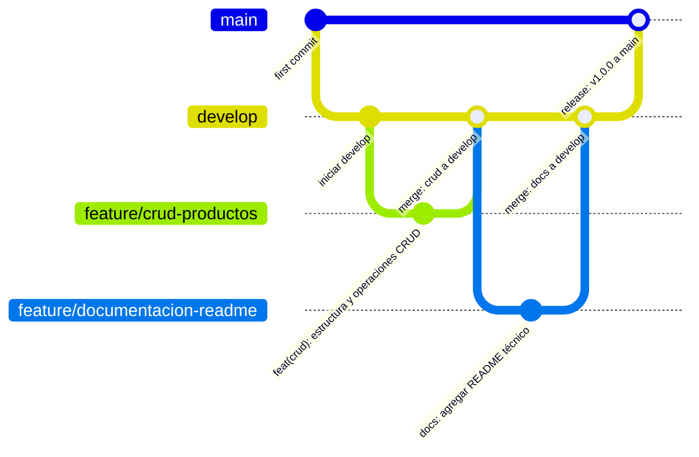

# Taller 1: Aplicación CRUD en Dart + Gitflow

[](https://dart.dev)
[](https://www.atlassian.com/git/tutorials/comparing-workflows/gitflow-workflow)
[](LICENSE)
[](#)

Sistema de gestión de catálogo e inventario de productos para consola desarrollado en **Dart**, implementando estructuras de datos fundamentales (**Listas**, **Mapas**), estructuras de control de flujo (**Ciclos**, **Switch-Case**) y la metodología de trabajo colaborativo **Gitflow**.

---

## Tabla de Contenido
1. [Descripción del Proyecto](#descripción-del-proyecto)
2. [Objetivos](#objetivos)
   - [Objetivo General](#objetivo-general)
   - [Objetivos Específicos](#objetivos-específicos)
3. [Estructura del Proyecto](#estructura-del-proyecto)
4. [Estructuras de Datos y Tecnologías](#estructuras-de-datos-y-tecnologías)
5. [Módulos y Funcionalidades del CRUD](#módulos-y-funcionalidades-del-crud)
   - [1. Menú Principal](#1-menú-principal)
   - [2. Agregar Producto](#2-agregar-producto)
   - [3. Listar Productos](#3-listar-productos)
   - [4. Actualizar Producto (Actualización Parcial o Total)](#4-actualizar-producto-actualización-parcial-o-total)
   - [5. Eliminar Producto](#5-eliminar-producto)
   - [6. Salir](#6-salir)
6. [Cómo Ejecutar el Proyecto](#cómo-ejecutar-el-proyecto)
7. [Metodología Gitflow y Control de Versiones](#metodología-gitflow-y-control-de-versiones)
8. [Equipo de Desarrollo y Asignación de Actividades](#equipo-de-desarrollo-y-asignación-de-actividades)

---

## Descripción del Proyecto
Este proyecto consiste en una aplicación de consola en **Dart** diseñada para que una tienda pueda administrar de manera eficiente su catálogo de productos. Permite realizar operaciones completas de creación, lectura, actualización y eliminación (**CRUD**) de artículos en memoria, garantizando la integridad de los datos mediante validaciones estrictas y proporcionando una experiencia de usuario clara e intuitiva en la terminal.

---

## Objetivos

### Objetivo General
Desarrollar una aplicación CRUD en Dart desde consola para gestionar un catálogo de productos de una tienda, permitiendo crear, listar, actualizar y eliminar productos mediante el uso de listas, mapas, ciclos y estructuras de selección múltiple `switch-case`.

### Objetivos Específicos
- **Modelar el catálogo:** Implementar una colección en memoria basada en `List<Map<String, dynamic>>` para registrar cada producto con sus propiedades (`nombre`, `precio`, `cantidad`).
- **Controlar el flujo del programa:** Utilizar ciclos (`while`) para mantener activo el menú interactivo hasta que el usuario decida salir explícitamente.
- **Manejar opciones mediante `switch-case`:** Centralizar el enrutamiento de las operaciones del usuario a través de una estructura de casos limpios y desacoplados.
- **Validar entradas de usuario:** Controlar errores de formato, entradas vacías, precios no válidos (menores o iguales a cero) y números de índice fuera de rango.
- **Permitir actualización selectiva:** Implementar la lógica para que el usuario pueda modificar uno, varios o todos los atributos de un producto, manteniendo intactos los valores no modificados al presionar `[ENTER]`.
- **Aplicar Gitflow:** Seguir una estrategia de ramas ordenada (`main`, `develop`, ramas `feature/`), con commits semánticos y modulares.

---

## Estructura del Proyecto

```text
Taller1-Dart/
│
├── .gitignore             # Archivos y carpetas ignorados por Git
├── pubspec.yaml           # Metadatos del proyecto Dart y dependencias
├── README.md              # Documentación técnica completa del proyecto
└── bin/
    └── main.dart          # Punto de entrada de la aplicación y lógica CRUD
```

---

## Estructuras de Datos y Tecnologías

| Componente | Tipo / Herramienta | Propósito en el Proyecto |
| :--- | :--- | :--- |
| **Dart SDK** | 3.13+ | Lenguaje y entorno de ejecución multiplataforma. |
| **Lista (`List`)** | `List<Map<String, dynamic>>` | Almacena ordenadamente la colección de todos los productos en el catálogo. |
| **Mapa (`Map`)** | `Map<String, dynamic>` | Representa cada producto como par clave-valor: `nombre` (String), `precio` (double), `cantidad` (int). |
| **Ciclo `while`** | Estructura de repetición | Mantiene el menú en ejecución continua hasta que se selecciona la opción de salida. |
| **`switch-case`** | Estructura de selección | Evalúa la opción numérica ingresada y ejecuta el módulo correspondiente. |
| **`dart:io`** | Librería estándar | Manejo de entrada y salida por consola (`stdin.readLineSync`, `stdout.write`, `print`). |

---

## Módulos y Funcionalidades del CRUD

### 1. Menú Principal
Despliega un menú con las 5 opciones requeridas y solicita una opción numérica (1-5):
```text
================= MENÚ PRINCIPAL =================
1. Agregar producto
2. Listar productos
3. Actualizar producto
4. Eliminar producto
5. Salir
==================================================
```

### 2. Agregar Producto
- Solicita de manera obligatoria:
  - **Nombre del producto:** No se permiten textos vacíos.
  - **Precio:** Debe ser un valor numérico positivo (`double > 0`).
  - **Cantidad disponible:** Debe ser un número entero mayor o igual a 0 (`int >= 0`).
- Registra el nuevo producto en un mapa y lo añade a la lista principal.

### 3. Listar Productos
- Imprime una tabla organizada con:
  - Número de índice (1-indexado para facilidad del usuario).
  - Nombre del producto.
  - Precio formateado a dos decimales (`$ 0.00`).
  - Cantidad disponible en stock.
- En caso de no existir productos registrados, muestra un mensaje descriptivo: `"No hay productos registrados en el catálogo."`.

### 4. Actualizar Producto (Actualización Parcial o Total)
- Presenta la lista actual y solicita el índice del producto a modificar.
- Valida que el índice pertenezca al rango disponible.
- Muestra el valor actual de cada campo (`nombre`, `precio`, `cantidad`).
- **Regla de actualización parcial:** Si el usuario no desea modificar un campo, simplemente presiona `[ENTER]` y el sistema preserva el valor original. Si ingresa un nuevo dato válido, el campo se actualiza.

### 5. Eliminar Producto
- Solicita el índice del producto a borrar previa visualización de la lista.
- Valida límites de rango.
- Solicita confirmación explícita (`S/N`) antes de remover el producto para prevenir pérdidas accidentales.
- Utiliza `.removeAt(indice)` para eliminarlo de la lista.

### 6. Salir
- Finaliza la ejecución del ciclo principal y muestra un mensaje cordial de despedida.

---

## Cómo Ejecutar el Proyecto

### Requisitos Previos
Tener instalado el **Dart SDK** (versión 3.0.0 o superior). Puede verificar su instalación ejecutando:
```bash
dart --version
```

### Pasos de Ejecución
1. Clonar el repositorio:
   ```bash
   git clone https://github.com/jonathanmarin50-cloud/Taller1-Dart.git
   cd Taller1-Dart
   ```

2. Ejecutar la aplicación:
   ```bash
   dart run bin/main.dart
   ```
   *(o simplemente `dart run`)*

---

## Metodología Gitflow y Control de Versiones

Para este proyecto se implementó la metodología **Gitflow**:



### Ramas del Repositorio
- **`main`**: Rama que contiene el código estable y listo para entrega.
- **`develop`**: Rama base para el desarrollo e integración continua.
- **`feature/crud-productos`**: Implementación de la lógica del catálogo, funciones CRUD, listas y mapas.
- **`feature/documentacion-readme`**: Elaboración de la documentación técnica y guía de usuario.

---

## Equipo de Desarrollo y Asignación de Actividades

| Integrante | Rol | Actividades Asignadas | Estado |
| :--- | :--- | :--- | :---: |
| **Jonathan Marin** | Líder de Desarrollo & Arquitecto de Software | • Configuración inicial del repositorio y ramas en Git.<br>• Creación del proyecto Dart (`pubspec.yaml`, `.gitignore`).<br>• Implementación de la arquitectura del CRUD en `bin/main.dart`.<br>• Programación de la validación de tipos, errores y entradas.<br>• Implementación de la lógica de actualización parcial.<br>• Redacción del README técnico completo.<br>• Coordinación y ejecución del flujo de ramas Gitflow. | **Completado** |

---

> Desarrollado para la materia/módulo de programación en Dart.
